# Translator (XL Translator)

[简体中文](README.md) | **English**

Translator is an open-source desktop application for macOS and Windows that uses large language models to batch-translate **Excel, Word, PowerPoint, PDF, image and CAD (DWG / DXF) files**. Excel, Word and PowerPoint files are output in bilingual form by default, with an option to keep the translation only. Translated segments are stored in a translation memory and reused in later jobs to keep terminology consistent. Other file types can be added through extensions, and AI agents can use Translator as an MCP server.

[Download the latest release](https://github.com/KlaraGraff/XL_Translator/releases/latest)

## Features

### Translation start page and search

The Translation page is the entry point of the application: drop files or folders anywhere in the window and Translator opens the matching translation page. After dropping a folder that holds spreadsheets, documents, presentations and other files together, the Translation page lists each kind of file with its settings; click Start all to translate them together, with the results in one output folder.

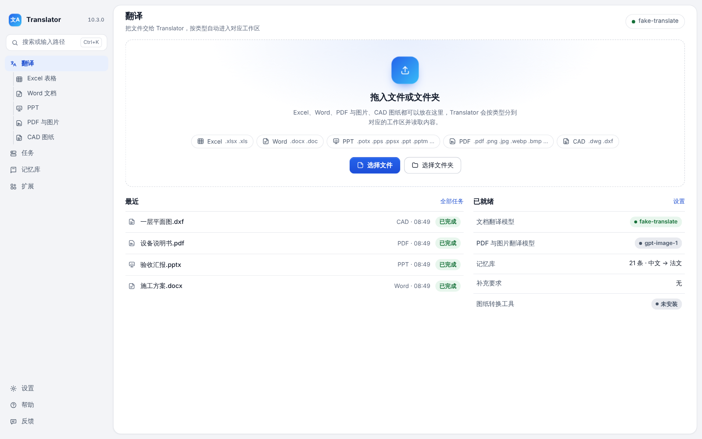


Press ⌘K (macOS) or Ctrl+K (Windows) to search pages, tasks and translation memory entries; type a file path and press Enter to start translating it.

### Excel

Supports `.xlsx` and legacy `.xls` files. Sheet names, displayed values of formula cells and file names can also be translated. Row heights can be adjusted to fit the translation, or kept fixed with the font size reduced. Cells requiring review are highlighted. When only part of a cell is bold or colored, the translation keeps that formatting in the matching place. Model numbers and standard codes such as `GB/T 8163-2018` are left unchanged.


<p align="center">
  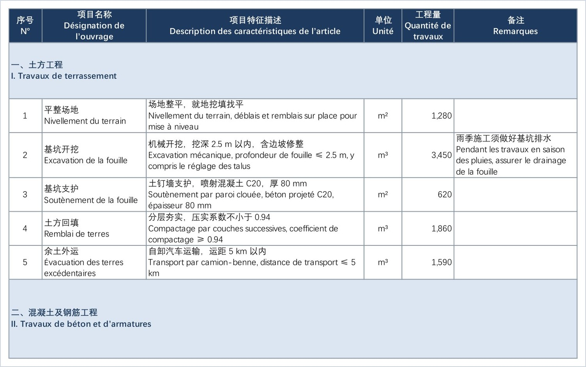
</p>
<p align="center"><sub>Bilingual output: in each cell, the source text above and the translation (French) below.</sub></p>

### Word

Supports `.docx` and legacy `.doc` files, including body text, tables, headers and footers. Cover pages and tables of contents can be excluded from translation, and automatic numbering is preserved. Bold and color applied to part of a paragraph, as well as tab stops, line breaks, pictures and footnote numbers, stay where they were after translation. Text boxes and footnotes are not yet translated and are reported when detected.


<p align="center">
  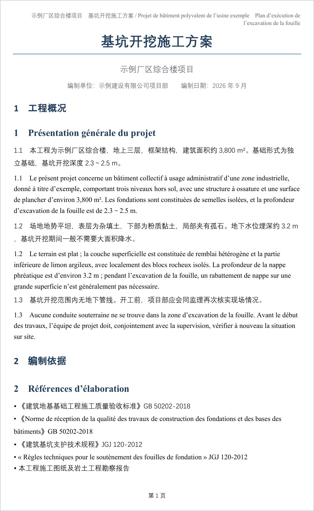
</p>
<p align="center"><sub>Bilingual output: the French translation follows each paragraph; headings and headers are paired in the same way.</sub></p>

### PowerPoint

Supports `.pptx`, `.pptm`, `.ppsx` and `.potx`; legacy `.ppt` and `.pps` files are converted first and come out as `.pptx` (conversion uses PowerPoint or LibreOffice installed on the computer). Text boxes, shapes and tables on the slides, text in charts and SmartArt, speaker notes, and fixed text on masters and layouts are translated, keeping bold, colors and hyperlinks as in the original. The default output is translation only; bilingual output with the source and translation together is also available. Text in pictures, embedded objects and comments is not translated, and reading the file reports how many of each there are.

When a translation is longer than the source and does not fit, Layout preference on the right of the page sets how it is handled: Adaptive layout (default) first makes text boxes and tables taller into the empty space below and then reduces the font size; Keep font size leaves the size unchanged and makes boxes taller as needed; Fixed layout keeps the size and position of every box and table and only reduces the font size. Anything that still does not fit is listed for review.

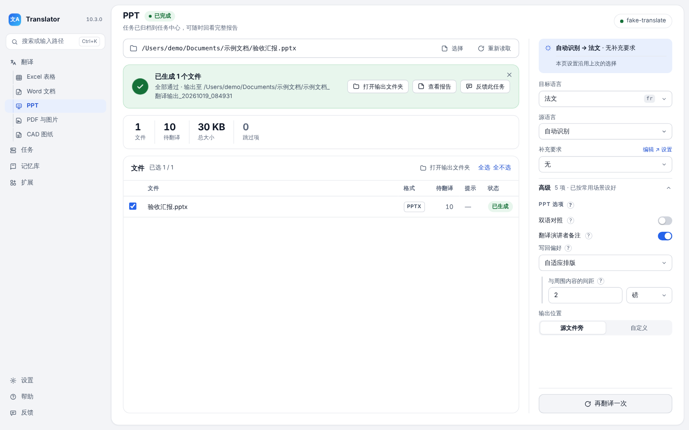

### PDF and images

Each page is redrawn in the target language by an image model, preserving the original layout and graphics as closely as possible. Supported image formats are PNG, JPG, WebP, BMP and TIFF. A review model can optionally check each page; individual pages can be regenerated after translation, and a compressed copy of the PDF can be saved.


<p align="center">
  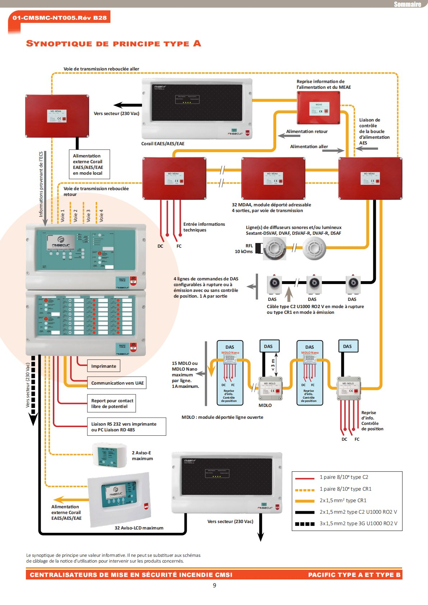
  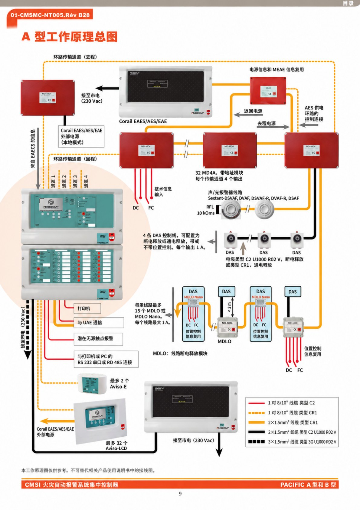
</p>
<p align="center"><sub>Left: original page (French). Right: translated page (Chinese).</sub></p>

<p align="center">
  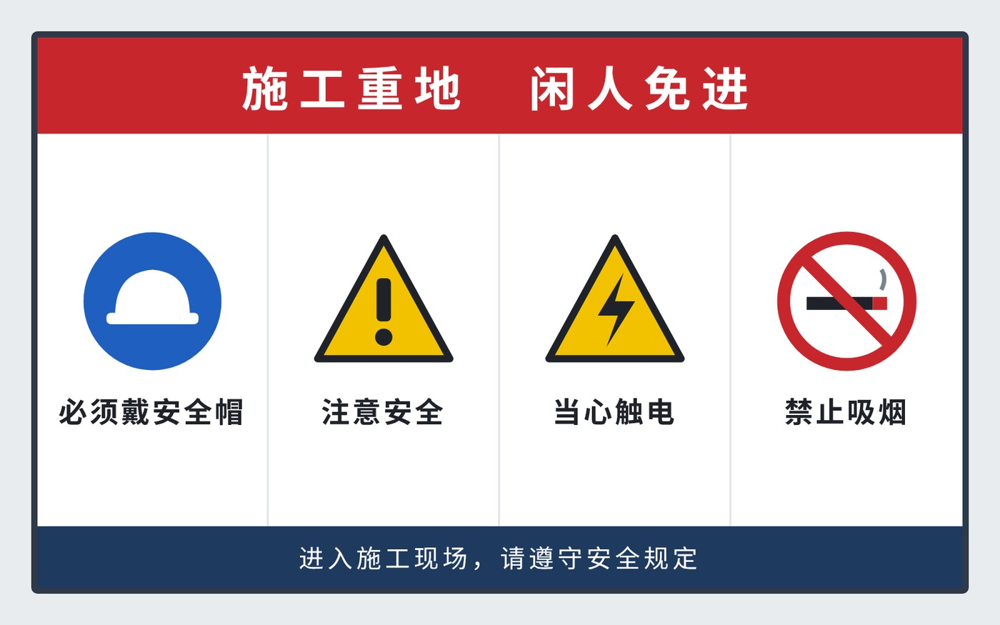
  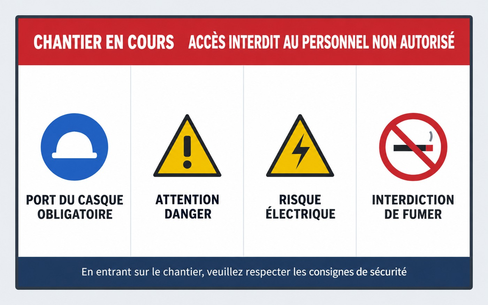
</p>
<p align="center"><sub>Images are redrawn in the same way: original (Chinese) on the left, translation (French) on the right.</sub></p>

### CAD drawings

DXF files are translated directly. DWG files require ODA File Converter, installed as the Drawing converter under Extensions → Components; conversion runs as part of the job. Text inside blocks can be included. Legacy drawings in GBK or other Chinese encodings are read and written correctly, including Chinese text saved in the special encoding used by older CAD software.

How translations are written back is set under Writing translations on the right of the page:

- Display: Translation only, Source above translation, or Translation above source. In bilingual mode, the translation is placed on the same layer as the source.
- Translation font: translations are written in AutoCAD's built-in fonts by default, so they display correctly on other computers; the original font can be kept instead.
- Auto-shrink long translations: when a translation would overlap neighboring text, it is first narrowed and then reduced in size (to 70% first, down to 40% at most). Anything that still does not fit is listed in the report for review.
- Do not translate: text in specified blocks and layers, such as title blocks and frames, is left unchanged. Names can be typed in or picked from the drawings.
- Layout: long translations are shrunk automatically so they do not extend past the drawing frame or out of table cells, or overlap nearby text, door swings and arrows; translations that do not fit in a narrow cell wrap onto two lines; translations in the same column of notes keep the same text height.


The images below show a sample drawing as displayed in AutoCAD, with the original and the translation of the same view one above the other.

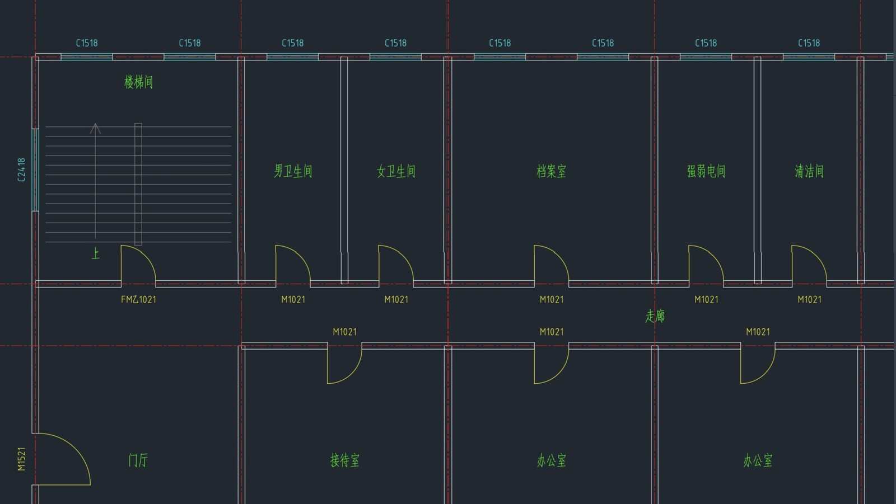

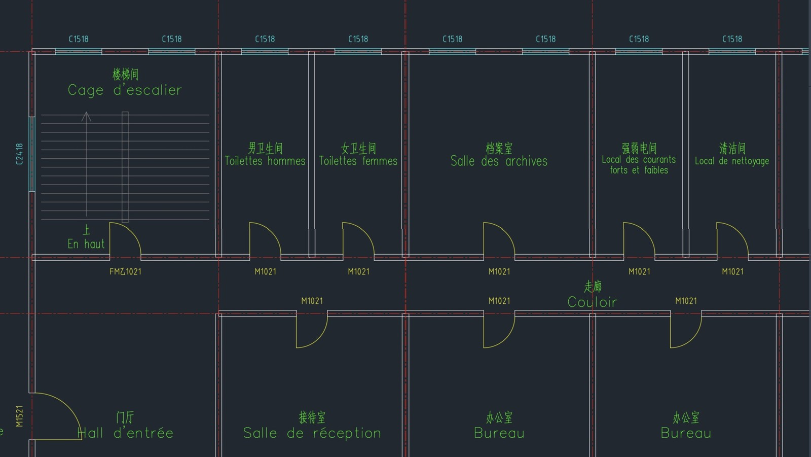

<p align="center"><sub>Top: original (Chinese). Bottom: translation (French, source above translation).</sub></p>

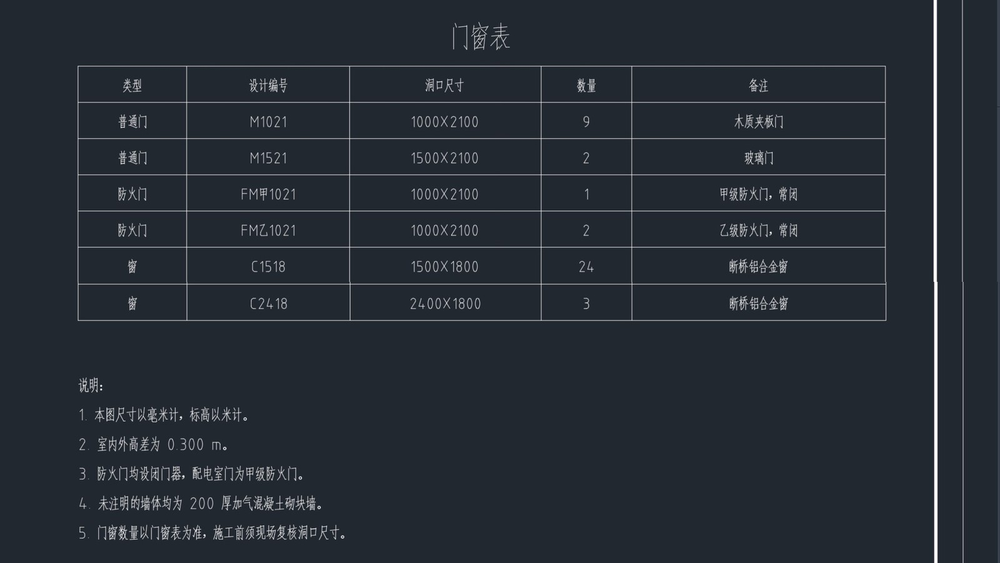

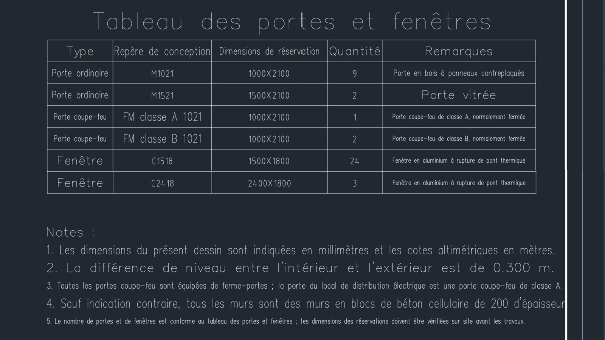

<p align="center"><sub>Top: schedule and notes, original (Chinese). Bottom: translation (French, translation only).</sub></p>

### Translation memory

Translations from Excel and Word jobs are stored automatically and reused first when translating Excel, Word and CAD files. Manually maintained entries always use the specified translation. The memory supports import, export and cleanup.


### Tasks

Jobs of different types can run concurrently. Any job can be stopped (PDF and CAD jobs can also be paused) and later resumed to translate only the remaining content. Each job records its statistics, items requiring review and output files.


### Checks after translation

When a number, ID number, date or name in the translation differs from the source, it is marked for review, with the original shown in the review list. Examples are a changed letter in an ID number, day and month swapped, or a misspelt name. The check reports only when there is clear evidence, never changes the translation, and applies to Excel, Word and PowerPoint.

### Feedback

The Feedback page in the sidebar is used to report problems or suggest improvements. A description can be entered and screenshots pasted directly; system and version information, logs of selected tasks, source files and translations can be attached as needed (source files and translations are not attached by default). A failed job can also be reported from the Tasks page with Report this problem. Everything that will be sent can be reviewed beforehand, upload progress is shown while sending, and the package can be saved as a ZIP file instead. API keys and file paths are removed from logs, and uploaded files are deleted automatically after 90 days. If an email address is provided, a notification is sent when the issue is resolved or the feature is released.


### Appearance

Light and dark modes are available and can follow the system setting. Six color schemes can be selected under Settings → Appearance & language: Lumen (default), Neutral grey, Warm paper, Soft cool, Celadon and Amber comfort. Light and dark mode can each use a different scheme, for example Neutral grey by day and Amber comfort at night.

### Languages and prompts

59 built-in languages, automatic source-language detection and custom target languages are supported.

Each translation page has an Auto-detect switch, on by default. Before translation, the document is read once to identify its type and field, and short standalone words are interpreted accordingly; for example, 甲 in a drawing's door number is not translated as "Party A" as in a contract. With the switch on, each file uses one additional model request. For longer documents (roughly 3,000 characters or more), the translation of each recurring term is also fixed before translating and used throughout; this applies to Excel, Word and CAD.

Prompts consist of fixed built-in rules and optional extra instructions. The built-in rules are always sent, and extra instructions are only appended after them, never replacing them. Extra instructions are set separately for Excel, Word and CAD under Settings → Translation options, and can be exported and imported.


### Extensions

Besides Excel, Word, PowerPoint, PDF and CAD, other file types can be translated through extensions, such as the bundled Text type (.txt, .md), which appears in the sidebar once switched on under Extensions → File types. The Extensions page also holds Components (optional components such as the Drawing converter, the text recognition component and the PDF processing component) and Agent access. The File types tab lets you browse and install reviewed extensions from the extension list, or add an extension package someone sent you; extensions are written by third-party authors and run with your user permissions, so only install them from sources you trust. To build your own, start from the [extension template](https://github.com/KlaraGraff/XL_Translator-extension-template) and submit it to the [extension list](https://github.com/KlaraGraff/XL_Translator-extensions) to share it; the steps are in [docs/EXTENSIONS.md](docs/EXTENSIONS.md) (Chinese).

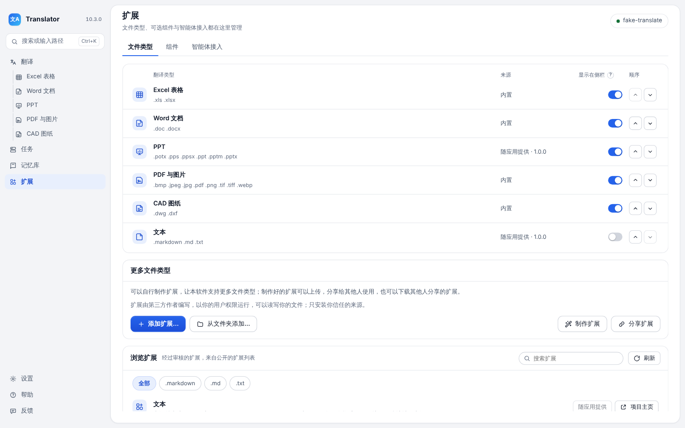

## Model services

Configure the provider, model name and API key under Settings → Models and test the connection before use. Text translation, image translation, and memory cleanup can each use a different model.

If the service briefly fails or times out, the batch is resent automatically and moves to a backup connection if it still fails. For Excel and CAD, the number of resends can be set under Settings → Translation options (0 to 5, default 2). If the API key is rejected or the quota is exhausted, the job stops immediately with an explanation.

| Type | Supported services |
|---|---|
| Cloud | OpenAI, Claude (Anthropic), DeepSeek, Zhipu GLM, Alibaba Qwen (DashScope), SiliconFlow and other OpenAI-compatible APIs |
| Local | Ollama, LM Studio and other OpenAI-compatible local servers |
| PDF and images | Requires an image generation model: OpenAI, SiliconFlow or an OpenAI-compatible API |

Files are read and written locally. Only the text to be translated (page images for PDF and image files) is sent to the configured model service. When a local model is used, document content does not leave the computer.


## System requirements and downloads

Two native installers are available:

- macOS (Apple Silicon): `Translator_macOS_arm64_<version>.dmg`, requires **macOS 12.0 Monterey or later**
- Windows (x64): `Translator_Windows_x64_<version>_Setup.exe`, requires **Windows 10 or later**

Installers are available on the [latest release page](https://github.com/KlaraGraff/XL_Translator/releases/latest), each with a `.sha256` checksum file of the same name. Intel Macs are not supported; users on Intel Macs should continue to use an earlier version.

### Installing on macOS

Verify the download in Terminal:

```bash
cd ~/Downloads
shasum -a 256 -c Translator_macOS_arm64_<version>.dmg.sha256
```

The output should read `OK`.

1. Open the verified DMG and drag `Translator.app` into the Applications folder.
2. Launch Translator from Applications.
3. The signing status of each version is stated in its release notes. Builds signed with a Developer ID and notarized by Apple open directly. For ad-hoc signed builds that are not notarized, macOS reports that the developer cannot be verified; select "Open Anyway" under System Settings → Privacy & Security. Only install a DMG downloaded from the official release page and verified as described above.

On macOS, application data is stored in `~/Library/Application Support/Translator`.

### Installing on Windows

Verify the download in PowerShell; the hash must match the value in the `.sha256` file:

```powershell
Get-FileHash "$env:USERPROFILE\Downloads\Translator_Windows_x64_<version>_Setup.exe" -Algorithm SHA256
Get-Content "$env:USERPROFILE\Downloads\Translator_Windows_x64_<version>_Setup.exe.sha256"
```

1. Run the verified `Setup.exe`. The installer writes only to the current user's folder and does not require administrator rights.
2. The Windows installer is not yet code-signed, so SmartScreen may display "Windows protected your PC". After verifying the checksum, select "More info → Run anyway". Do this only for an installer downloaded from the official release page and verified.
3. The interface requires the Microsoft Edge WebView2 runtime. If it is not installed, the installer downloads and installs it automatically. This is the only step of the initial installation that may require an internet connection.

On Windows, application data is stored in `%LOCALAPPDATA%\Translator`.

## First launch

On first launch, a quick-start guide is displayed; data from other folders is not imported automatically. Existing data in the application data folder is read or upgraded according to the compatibility rules. If data is found to be damaged, the original file is backed up, a new data file is created, and the backup location is shown in Settings. If the original file cannot be read, backed up or recreated, it is kept in place and the reason is reported; recovery of its contents is not guaranteed.

## Usage notes

Standard `.xlsx`, `.docx`, PDF, image and DXF files do not require Microsoft Office. High-fidelity conversion of legacy `.xls` and `.doc` files and certain numbering corrections can use Microsoft Office, LibreOffice or system converters installed on the computer. DWG drawings require ODA File Converter. These programs are optional and are not included with Translator. When one is needed, the application explains the required permissions, the expected format fidelity and the impact of any fallback.

Before translating, configure a model service under Settings → Models and test the connection. The quick-start guide does not send API requests automatically. Help, update checks, maintenance and anonymized diagnostics are built into the application. Diagnostics are never uploaded automatically and do not include API keys, source text, translations or complete prompts.

### Exporting and importing configurations

The complete model configuration can be exported under Settings → Models for use by others. Exports without keys are plain `.json` files. Exports with keys are encrypted `.xltcfg` files: the keys are encrypted with a key built into the application, and a modified file cannot be imported. Exports can be valid for 7, 30 or 90 days, or without expiry.

Security note: any user with the application installed can decrypt an `.xltcfg` file. The encryption only protects the file from unrelated parties during transfer, not from users who have the application. Do not share configuration files containing keys in public groups or cloud folders. Exports include only keys entered manually on the local computer; keys imported from another configuration are never exported again.

## Connecting AI agents

Translator can act as an MCP server for agents such as Claude Desktop, Claude Code and Cursor. An agent can list the supported file types, scan files, start a translation, check its progress and retrieve the paths of the output files. The same program can also be used from a terminal. While Translator is open, tasks appear on the Tasks page; otherwise the translation engine runs in the background and exits when done. Models, languages and translation options follow the application settings, so a model service must be configured in the application first. Translations are written to a new folder next to the source files, and the source files are never modified.

The simplest way to connect: open the Extensions page from the sidebar, go to the Agent access tab, click Copy setup instructions, and paste them into a message to the agent, which completes the setup itself. Restart the agent if prompted, and it is ready to use. Manual setup is described below.

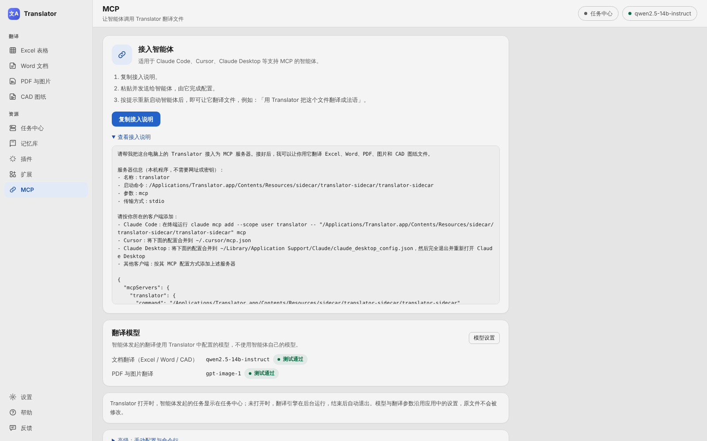

Location of the translation engine:

- macOS: `/Applications/Translator.app/Contents/Resources/sidecar/translator-sidecar/translator-sidecar`
- Windows: `C:\Users\<user name>\AppData\Local\Translator\sidecar\translator-sidecar\translator-sidecar.exe`

The Advanced section of the Agent access tab shows the actual path on the computer, with the configuration and command ready to copy. The examples below use the macOS path. When a Windows path is written in JSON, each `\` must be written as `\\`. If the configuration file already lists other servers, add the `translator` entry to the existing `mcpServers`.

**Claude Desktop**: open `claude_desktop_config.json` from Settings → Developer → Edit Config (located in `~/Library/Application Support/Claude/` on macOS and `%APPDATA%\Claude\` on Windows), add the following and restart Claude Desktop.

```json
{
  "mcpServers": {
    "translator": {
      "command": "/Applications/Translator.app/Contents/Resources/sidecar/translator-sidecar/translator-sidecar",
      "args": ["mcp"]
    }
  }
}
```

**Claude Code**: run the following command in a terminal to make Translator available in all projects. To use it in a single project only, save the JSON above as `.mcp.json` in the project root.

```bash
claude mcp add --scope user translator -- /Applications/Translator.app/Contents/Resources/sidecar/translator-sidecar/translator-sidecar mcp
```

**Cursor**: save the JSON above as `~/.cursor/mcp.json` (all projects; `%USERPROFILE%\.cursor\mcp.json` on Windows) or as `.cursor/mcp.json` in a project.

**Command line**: run the same program with a subcommand. For example, to translate a file into French and wait for it to finish:

```bash
"/Applications/Translator.app/Contents/Resources/sidecar/translator-sidecar/translator-sidecar" translate ~/Documents/checklist.xlsx --to fr --wait
```

`--help` lists all subcommands (`types`, `scan`, `translate`, `status`, `stop`, `mcp`). `translate --dry-run` only lists the files that would be translated and any confirmations required, without starting a translation. In Windows PowerShell, prefix a quoted path with `&`.

## Updates

The application checks for updates once in the background after startup and displays an indicator on Settings in the sidebar when a new version is available. Updates can be installed directly under Settings → Updates & about: the application downloads the official package, verifies its signature and replaces itself in place, and rejects any package whose signature does not match. On macOS, the user chooses when to restart; on Windows, the installer completes the update after confirming whether running jobs may be interrupted. Background update reminders can be paused, and specific versions can be skipped.

If in-app updating is unavailable (for example, when running directly from the DMG, when the installation folder is not writable, on an architecture mismatch, or in a development build), the application states the reason and directs the user to a manual download. If retrieving update information, downloading or installing fails, the application identifies the failed step, and the installed version remains unaffected.

Manual downloads are available from the official GitHub Releases page. The application accepts only complete release packages that match the system and architecture and include a SHA-256 checksum file.

## Development

The [architecture guide](docs/ARCHITECTURE.md) describes the code structure, the end-to-end execution of a job and where each type of change belongs. The steps for adding a translation module are listed in the [new translation module checklist](docs/ADDING_A_TRANSLATION_PAGE.md). Both documents are written in Chinese. The desktop shell is built with Tauri 2 (Rust), the interface with TypeScript, and the document engine with Python.

## License

This project is licensed under the [MIT License](LICENSE).
