# Translator（XL Translator）

Translator 是一款基于大语言模型的桌面文档翻译应用，支持批量翻译 **Excel、Word、PDF、图片及 CAD 图纸（DWG / DXF）**，适用于 macOS 与 Windows。Excel 与 Word 默认输出原文与译文对照的双语文件，也可仅保留译文。已翻译的词句存入翻译记忆库，供后续任务复用，以保持术语一致。

Translator is a desktop application for macOS and Windows that uses large language models to batch-translate **Excel, Word, PDF, image and CAD (DWG / DXF) files**. Excel and Word files are output in bilingual form by default, with an option to keep the translation only. Translated segments are stored in a translation memory and reused in later jobs to keep terminology consistent.

[下载最新版本 · Download the latest release](https://github.com/KlaraGraff/XL_Translator/releases/latest)

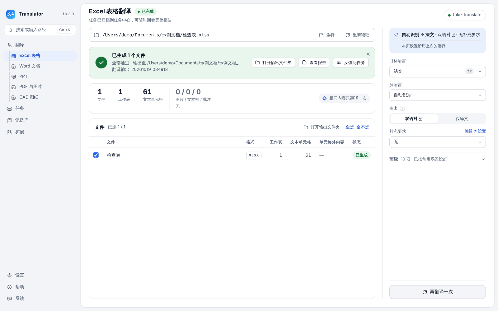

> 本页的界面截图与各功能下的翻译前后对照图对应同一批工程文档：Excel 与 PDF 为法译中，Word 与 CAD 图纸为中译法。截图中的文件名均为中性的示例名称，界面语言为中文，配色为默认的素雅灰。界面语言可在「设置 → 外观与语言」中切换为英语或法语；输出文件夹名称、报告文件及写入文档的复核标记目前仍为中文。
>
> The application screenshots and the before-and-after comparisons on this page use the same set of engineering documents: the Excel and PDF examples were translated from French into Chinese, and the Word and CAD examples from Chinese into French. File names in the screenshots are neutral sample names; the interface is set to Chinese with the default Neutral grey color scheme. The interface language can be changed to English or French under Settings → Appearance & language. Output folder names, report files and review markers written into documents remain in Chinese.

## 功能 · Features

### Excel

支持 `.xlsx` 及旧版 `.xls` 格式。可翻译工作表名称、公式单元格的显示值及文件名；行高可随译文自动调整，也可保持行高并缩小字号；需要复核的单元格以底色标出。型号、标准编号等内容（如 `GB/T 8163-2018`）保持原样。

Supports `.xlsx` and legacy `.xls` files. Sheet names, displayed values of formula cells and file names can also be translated. Row heights can be adjusted to fit the translation, or kept fixed with the font size reduced. Cells requiring review are highlighted. Model numbers and standard codes such as `GB/T 8163-2018` are left unchanged.

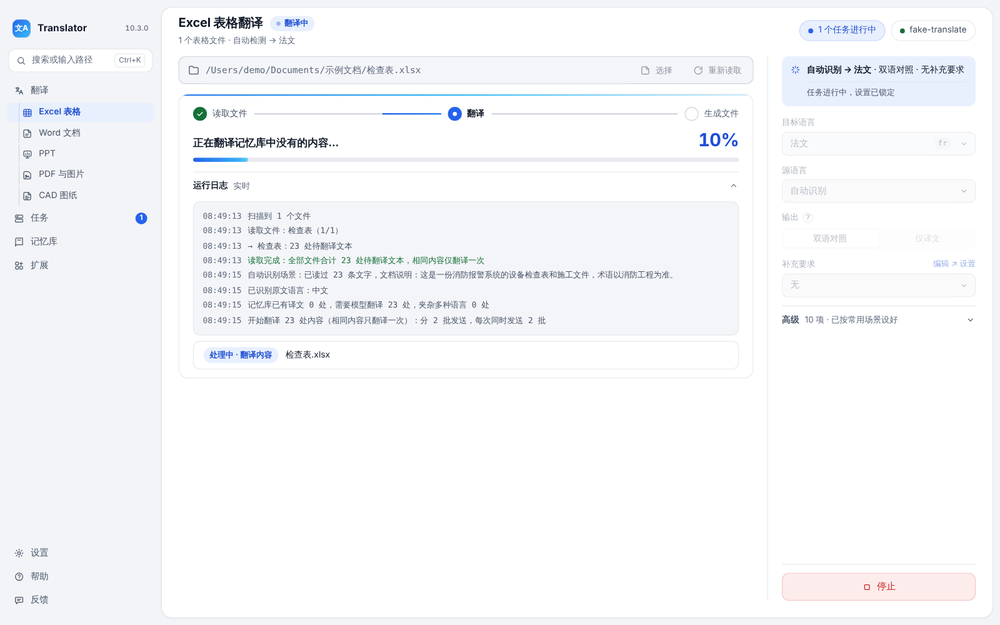

<p align="center">
  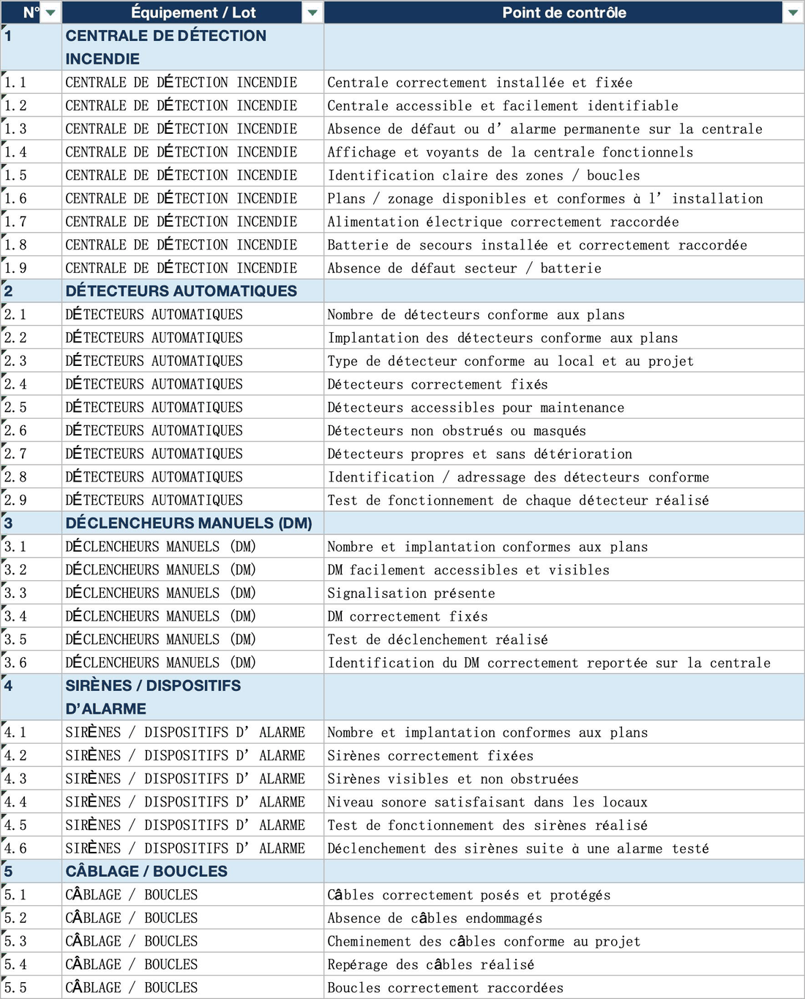
  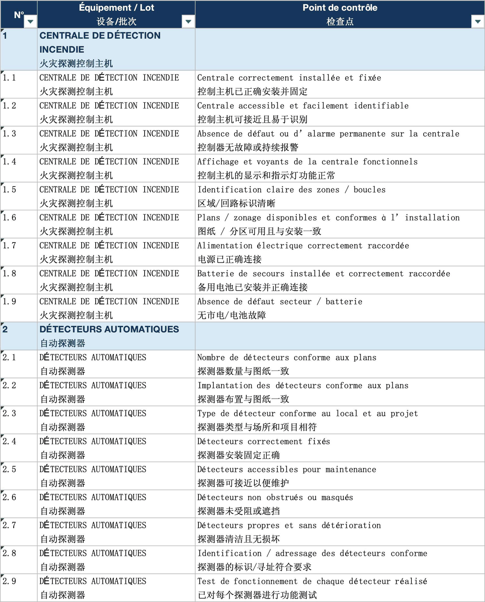
</p>
<p align="center"><sub>左：原文（法语）；右：双语输出，原文在上，中文译文在下 · Left: original (French). Right: bilingual output with the Chinese translation below the source text.</sub></p>

### Word

支持 `.docx` 及旧版 `.doc` 格式，可翻译正文、表格及页眉页脚。可选择不翻译封面和目录；自动编号在翻译后保持正确。文本框和脚注暂不翻译，检测到时将在结果中提示。

Supports `.docx` and legacy `.doc` files, including body text, tables, headers and footers. Cover pages and tables of contents can be excluded from translation, and automatic numbering is preserved. Text boxes and footnotes are not yet translated and are reported when detected.

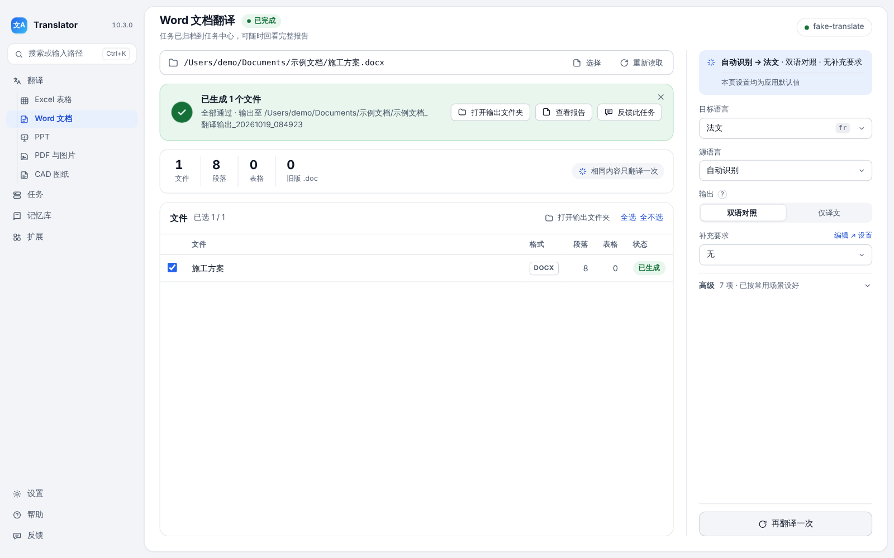

<p align="center">
  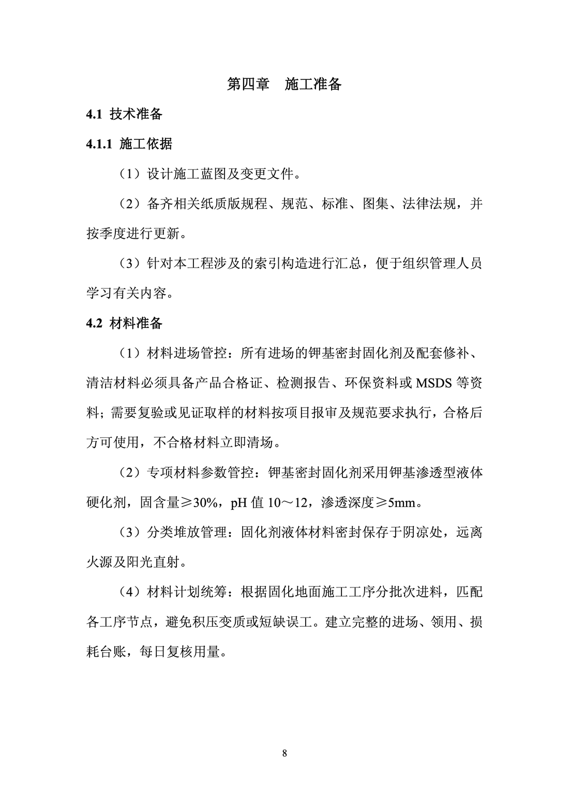
  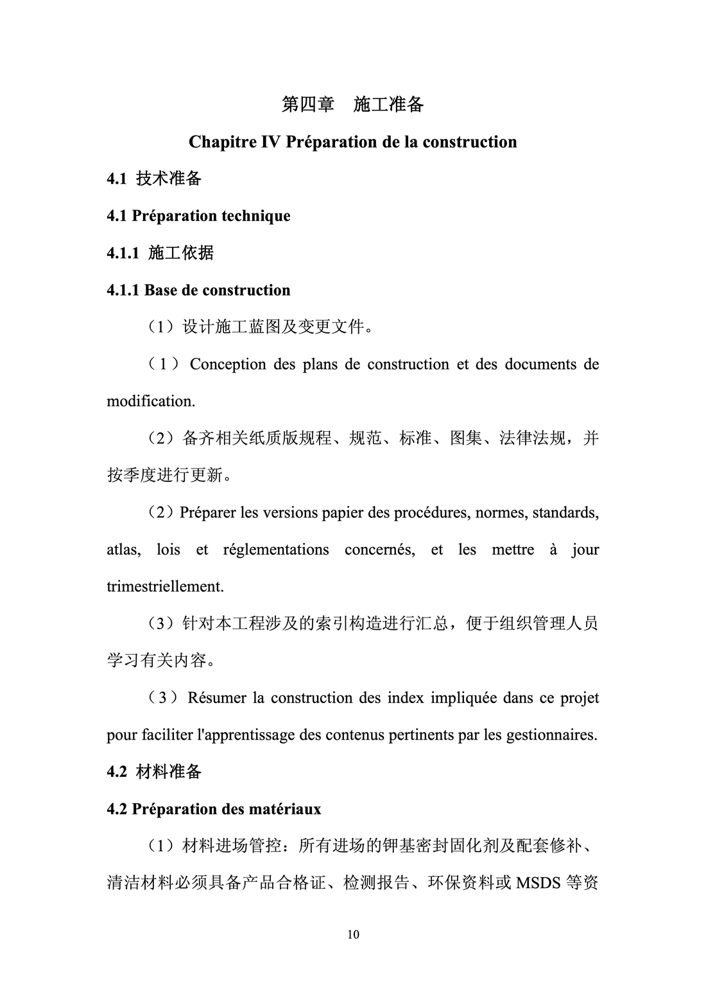
</p>
<p align="center"><sub>左：原文（中文）；右：双语输出，每段原文后附法语译文 · Left: original (Chinese). Right: bilingual output with the French translation after each paragraph.</sub></p>

### PDF 与图片 · PDF and images

由图像模型逐页将文字替换为目标语言，并尽量保留原有版式和插图。图片支持 PNG、JPG、WebP、BMP 和 TIFF 格式。可启用审核模型逐页检查，翻译完成后可单独重新生成指定页面，并可另存压缩版 PDF。

Each page is redrawn in the target language by an image model, preserving the original layout and graphics as closely as possible. Supported image formats are PNG, JPG, WebP, BMP and TIFF. A review model can optionally check each page; individual pages can be regenerated after translation, and a compressed copy of the PDF can be saved.

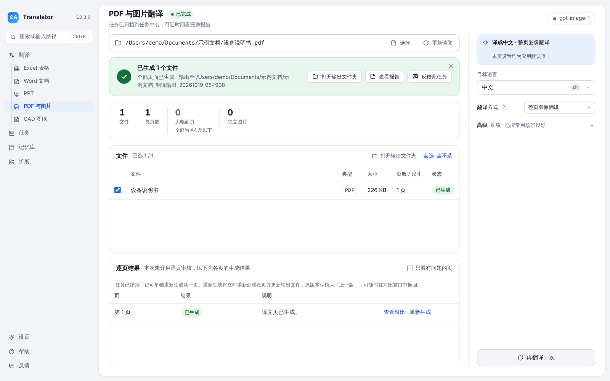

<p align="center">
  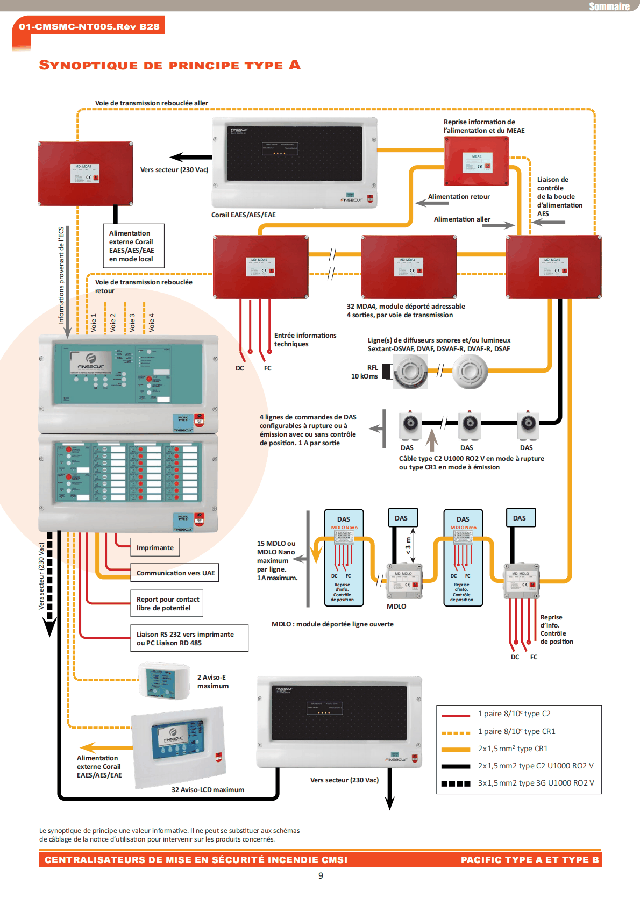
  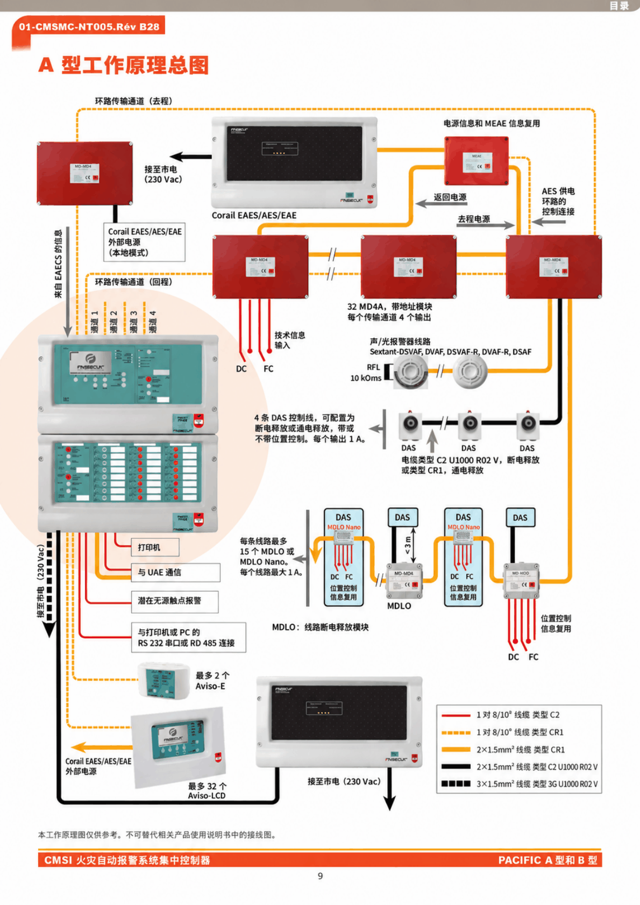
</p>
<p align="center"><sub>左：原文页面（法语）；右：译文页面（中文） · Left: original page (French). Right: translated page (Chinese).</sub></p>

### CAD 图纸 · CAD drawings

DXF 文件可直接翻译；DWG 文件需先在「插件」页面配置 ODA File Converter，格式转换在任务中进行。图块内的文字可一并翻译。GBK 等中文编码的旧图纸可正确读写，旧版 CAD 以特殊编码保存的中文也能正确识别。

译文写回方式可在页面右侧「译文写回」中设置：

- 显示方式：仅译文、原文在上译文在下，或译文在上原文在下；双语时译文与原文位于同一图层。
- 译文字体：默认使用 AutoCAD 自带字体写入译文，在其他电脑上打开也能正常显示；也可沿用原文字体。
- 超长译文自动缩小：译文较长、会压到相邻文字时，先收窄字宽，再缩小字号（默认先缩至 70%，最小 40%）；仍放不下的列入报告供复核。
- 锁定不翻译：指定图框、标题栏等图块和图层，其中的文字保持原样；名称可直接输入，也可从图纸中挑选。

DXF files are translated directly. DWG files require ODA File Converter, configured on the Plugins page; conversion runs as part of the job. Text inside blocks can be included. Legacy drawings in GBK or other Chinese encodings are read and written correctly, including Chinese text saved in the special encoding used by older CAD software.

How translations are written back is set under Writing translations on the right of the page:

- Display: Translation only, Source above translation, or Translation above source. In bilingual mode, the translation is placed on the same layer as the source.
- Translation font: translations are written in AutoCAD's built-in fonts by default, so they display correctly on other computers; the original font can be kept instead.
- Auto-shrink long translations: when a translation would overlap neighboring text, it is first narrowed and then reduced in size (to 70% first, down to 40% at most). Anything that still does not fit is listed in the report for review.
- Do not translate: text in specified blocks and layers, such as title blocks and frames, is left unchanged. Names can be typed in or picked from the drawings.

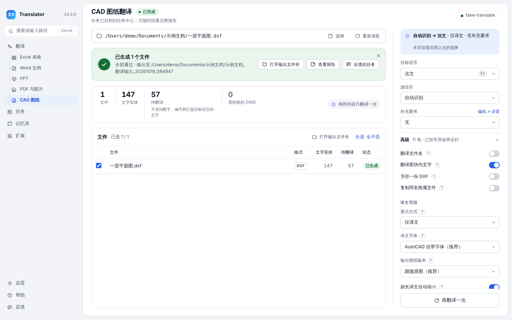

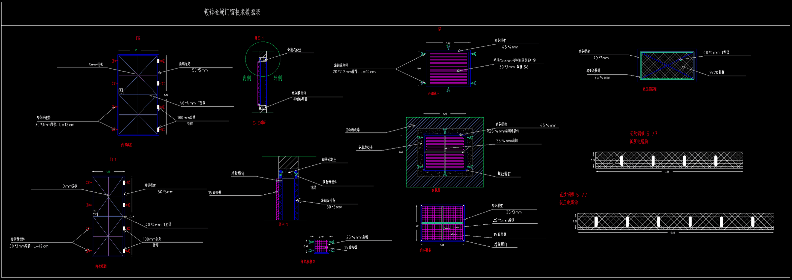

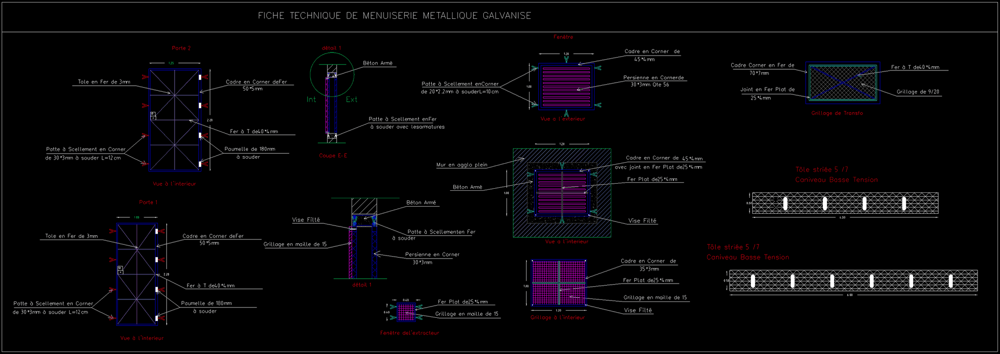

<p align="center"><sub>上：原图（中文）；下：译图（法语） · Top: original drawing (Chinese). Bottom: translated drawing (French).</sub></p>

### 记忆库 · Translation memory

Excel 与 Word 的翻译结果自动存入记忆库，在翻译 Excel、Word 和 CAD 图纸时优先复用。已固定的词条始终采用指定译法。记忆库支持导入、导出和清洗。

Translations from Excel and Word jobs are stored automatically and reused first when translating Excel, Word and CAD files. Pinned entries always use the specified translation. The memory supports import, export and cleanup.

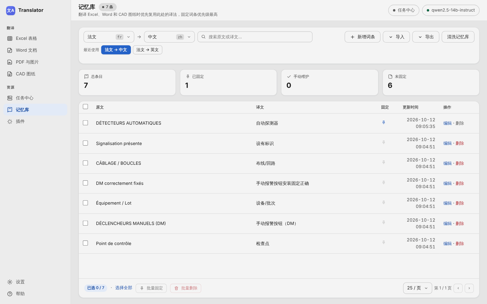

### 任务中心 · Task center

不同类型的任务可同时运行，任务可随时停止（PDF 和 CAD 任务还可暂停），之后可仅翻译剩余部分。每个任务均保留结果统计、待复核位置及输出文件。

Jobs of different types can run concurrently. Any job can be stopped (PDF and CAD jobs can also be paused) and later resumed to translate only the remaining content. Each job records its statistics, items requiring review and output files.

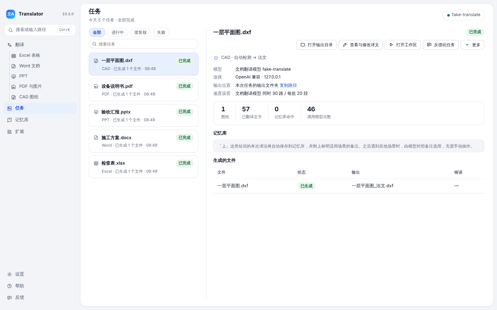

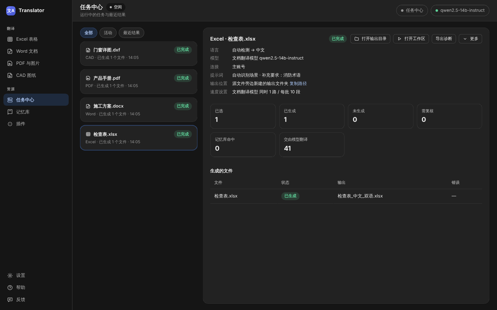

### 反馈 · Feedback

侧栏的「反馈」页用于报告问题或提出建议。可填写描述并直接粘贴截图，按需附带系统与版本信息、所选任务的日志、原文件和译文（原文件和译文默认不附带）；失败的任务也可在任务中心通过「反馈此问题」进入。发送前可查看将发送的全部内容，发送时显示上传进度，也可改为保存为 ZIP 文件。日志中的 API 密钥和文件路径已去除，随反馈上传的文件保存 90 天后自动删除。

The Feedback page in the sidebar is used to report problems or suggest improvements. A description can be entered and screenshots pasted directly; system and version information, logs of selected tasks, source files and translations can be attached as needed (source files and translations are not attached by default). A failed job can also be reported from the task center with Report this problem. Everything that will be sent can be reviewed beforehand, upload progress is shown while sending, and the package can be saved as a ZIP file instead. API keys and file paths are removed from logs, and uploaded files are deleted automatically after 90 days.

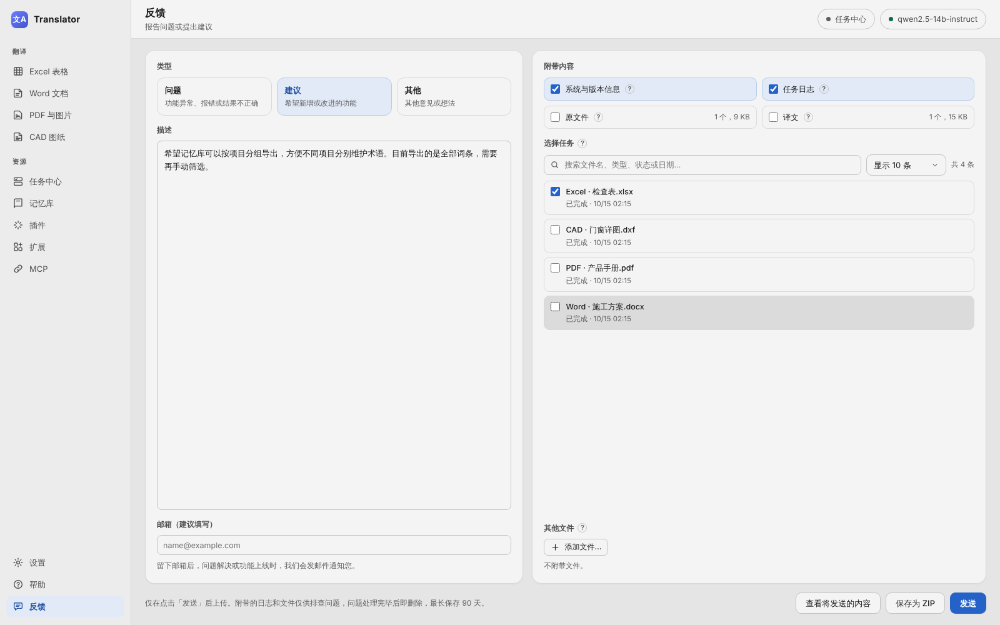

### 外观 · Appearance

界面提供浅色与深色模式，可跟随系统自动切换。在「设置 → 外观与语言」中可选择五套配色方案：素雅灰（默认）、暖调纸感、冷调柔光、青瓷和琥珀护眼；浅色和深色模式可分别选用不同的方案，例如白天使用素雅灰、夜间使用琥珀护眼。

Light and dark modes are available and can follow the system setting. Five color schemes can be selected under Settings → Appearance & language: Neutral grey (default), Warm paper, Soft cool, Celadon and Amber comfort. Light and dark mode can each use a different scheme, for example Neutral grey by day and Amber comfort at night.

### 语言与提示词 · Languages and prompts

内置 59 种语言，支持自动识别源语言及自定义目标语言。

各翻译页面提供「自动识别场景」开关，默认开启：翻译前先通读一遍文档，判断文档类型和所属专业，再据此理解单独出现的短词，例如图纸门号中的「甲」不会被译成合同中的「甲方」。开启后每份文件多调用一次模型。

提示词由固定的内置规则和可选的「补充要求」组成：内置规则每次都会发送，补充要求只追加在其后，不会替换内置规则。补充要求可在「设置 → 翻译参数」中按 Excel、Word、CAD 分别设置，并可导出和导入。

59 built-in languages, automatic source-language detection and custom target languages are supported.

Each translation page has an Auto-detect switch, on by default. Before translation, the document is read once to identify its type and field, and short standalone words are interpreted accordingly; for example, 甲 in a drawing's door number is not translated as "Party A" as in a contract. With the switch on, each file uses one additional model request.

Prompts consist of fixed built-in rules and optional Extra instructions. The built-in rules are always sent, and extra instructions are only appended after them, never replacing them. Extra instructions are set separately for Excel, Word and CAD under Settings → Translation options, and can be exported and imported.

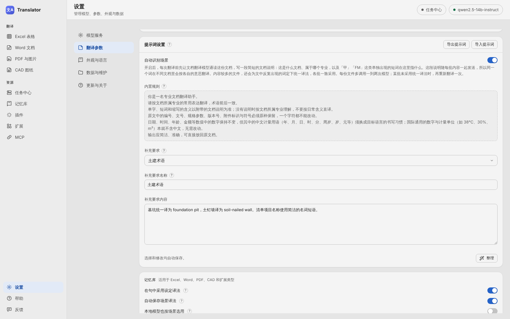

## 模型服务 · Model services

在「设置 → 模型服务」中填写服务商、模型名称和 API 密钥，测试连接成功后即可使用。文档翻译、PDF 与图片翻译、记忆库清洗可分别配置不同的模型。

Configure the provider, model name and API key under Settings → Models and test the connection before use. Document translation, PDF and image translation, and memory cleanup can each use a different model.

服务暂时出错或超时时，该批内容会自动重新发送，仍失败时改用备用连接。Excel 和 CAD 的重发次数可在「设置 → 翻译参数」中调整（0 至 5 次，默认 2 次）。API 密钥无效或额度用尽时，任务立即停止并说明原因。

If the service briefly fails or times out, the batch is resent automatically and moves to a backup connection if it still fails. For Excel and CAD, the number of resends can be set under Settings → Translation options (0 to 5, default 2). If the API key is rejected or the quota is exhausted, the job stops immediately with an explanation.

| | 中文 | English |
|---|---|---|
| 云端 · Cloud | OpenAI / ChatGPT、Claude（Anthropic）、DeepSeek、智谱 GLM、阿里百炼（通义）、硅基流动，以及其他 OpenAI 兼容接口 | OpenAI, Claude (Anthropic), DeepSeek, Zhipu GLM, Alibaba Qwen (DashScope), SiliconFlow and other OpenAI-compatible APIs |
| 本地 · Local | Ollama、LM Studio 及其他 OpenAI 兼容的本地服务 | Ollama, LM Studio and other OpenAI-compatible local servers |
| PDF 与图片 · PDF and images | 需使用支持图像生成的模型：OpenAI、硅基流动或 OpenAI 兼容接口 | Requires an image generation model: OpenAI, SiliconFlow or an OpenAI-compatible API |

文件的读取和写入均在本机完成，翻译时仅将待翻译文字（PDF 与图片为页面图像）发送至所配置的模型服务。使用本地模型时，文档内容不会离开本机。

Files are read and written locally. Only the text to be translated (page images for PDF and image files) is sent to the configured model service. When a local model is used, document content does not leave the computer.

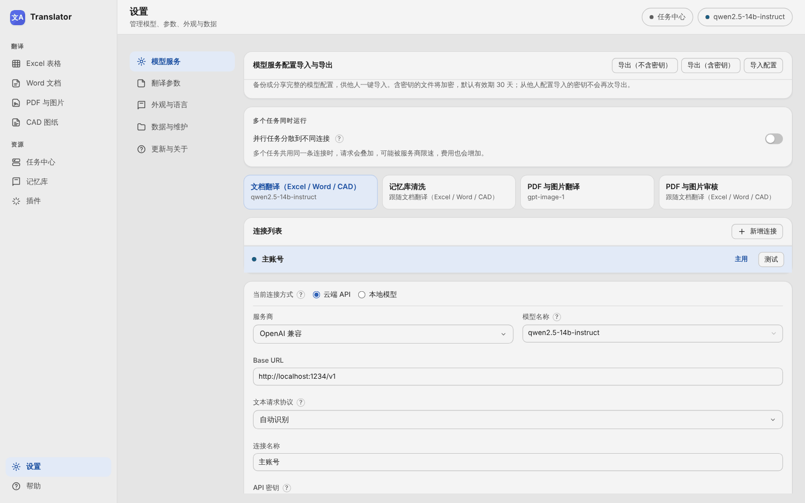

## V10.0.0 主要更新 · What's new in V10.0.0

- 新增 CAD 图纸翻译，操作流程与 Excel、Word、PDF 一致；可设置译文显示方式、译文字体、超长译文自动缩小及锁定不翻译的图块和图层
- 新增「自动识别场景」：翻译前先通读文档，按文档类型理解单独出现的短词
- 提示词改为固定的内置规则加可选的补充要求；原有的三个场景预设已删除，升级时旧设置自动迁移
- 侧栏新增「反馈」页，可附带截图、日志和文件，发送前可查看全部内容
- 新增英语和法语界面，可在「设置 → 外观与语言」中切换
- 新增五套配色方案（素雅灰、暖调纸感、冷调柔光、青瓷、琥珀护眼），浅色与深色模式可分别选择
- 统一界面、运行日志、错误信息和报告中的用语，不再出现程序内部术语
- API 密钥无效或额度用尽时，任务立即停止并说明原因；Excel 和 CAD 的失败重试次数可调整；持续限流时，先保存已完成的部分

<!-- English -->

- CAD drawing translation, with the same workflow as Excel, Word and PDF; translation display, translation font, auto-shrinking of long translations and blocks and layers to leave untranslated can be set
- Auto-detect: the document is read once before translation, and short standalone words are interpreted according to the document type
- Prompts now consist of fixed built-in rules plus optional extra instructions; the three former scene presets have been removed, and existing settings are migrated automatically on upgrade
- A new Feedback page in the sidebar, with screenshots, logs and files attachable and everything reviewable before sending
- English and French interface, selectable under Settings → Appearance & language
- Five color schemes (Neutral grey, Warm paper, Soft cool, Celadon and Amber comfort), selectable separately for light and dark mode
- Consistent terminology across the interface, run log, error messages and reports, without internal technical terms
- Jobs stop immediately with an explanation when the API key is rejected or the quota is exhausted; the number of retries for Excel and CAD can be adjusted; under sustained rate limiting, completed work is saved first

详见[发布页面](https://github.com/KlaraGraff/XL_Translator/releases/latest)及 [CHANGELOG](docs/CHANGELOG.md)。For details, see the [release page](https://github.com/KlaraGraff/XL_Translator/releases/latest) and the [CHANGELOG](docs/CHANGELOG.md).

## 系统要求与下载 · System requirements and downloads

当前版本提供两个原生安装包：

- macOS（Apple Silicon，M 系列芯片）：`Translator_macOS_arm64_<版本>.dmg`，要求 **macOS 12.0 Monterey 及以上版本**
- Windows（x64）：`Translator_Windows_x64_<版本>_Setup.exe`，要求 **Windows 10 及以上版本**

安装包可从[最新版本发布页](https://github.com/KlaraGraff/XL_Translator/releases/latest)下载，每个安装包均附有同名的 `.sha256` 校验文件。不提供 Intel Mac 版本的安装包及更新，Intel Mac 用户请继续使用旧版本。

Two native installers are available:

- macOS (Apple Silicon): `Translator_macOS_arm64_<version>.dmg`, requires **macOS 12.0 Monterey or later**
- Windows (x64): `Translator_Windows_x64_<version>_Setup.exe`, requires **Windows 10 or later**

Installers are available on the [latest release page](https://github.com/KlaraGraff/XL_Translator/releases/latest), each with a `.sha256` checksum file of the same name. Intel Macs are not supported; users on Intel Macs should continue to use an earlier version.

### macOS 安装与首次打开 · Installing on macOS

下载后可在终端中校验 · Verify the download in Terminal:

```bash
cd ~/Downloads
shasum -a 256 -c Translator_macOS_arm64_<版本>.dmg.sha256
```

校验结果应显示 `OK`。

1. 打开已校验的 DMG，将 `Translator.app` 拖入「应用程序」文件夹。
2. 从「应用程序」启动 Translator。
3. 各版本的签名状态以该版本的发布说明为准。若为 Developer ID 签名且已通过 Apple 公证，可直接打开；若为 ad-hoc 签名且未公证，macOS 会提示「无法验证开发者」，需在「系统设置 → 隐私与安全性」中选择「仍要打开」。请仅安装从官方发布页下载并通过校验的 DMG，不要使用其他来源的安装包。

The output should read `OK`.

1. Open the verified DMG and drag `Translator.app` into the Applications folder.
2. Launch Translator from Applications.
3. The signing status of each version is stated in its release notes. Builds signed with a Developer ID and notarized by Apple open directly. For ad-hoc signed builds that are not notarized, macOS reports that the developer cannot be verified; select "Open Anyway" under System Settings → Privacy & Security. Only install a DMG downloaded from the official release page and verified as described above.

macOS 的数据目录为 `~/Library/Application Support/Translator`。On macOS, application data is stored in `~/Library/Application Support/Translator`.

### Windows 安装与首次打开 · Installing on Windows

下载后可在 PowerShell 中校验，输出的哈希值应与 `.sha256` 文件中的值一致 · Verify the download in PowerShell; the hash must match the value in the `.sha256` file:

```powershell
Get-FileHash "$env:USERPROFILE\Downloads\Translator_Windows_x64_<版本>_Setup.exe" -Algorithm SHA256
Get-Content "$env:USERPROFILE\Downloads\Translator_Windows_x64_<版本>_Setup.exe.sha256"
```

1. 运行已校验的 `Setup.exe`。安装程序仅写入当前用户目录，无需管理员权限。
2. Windows 安装包目前未进行代码签名，SmartScreen 可能提示「Windows 已保护你的电脑」。完成校验后，选择「更多信息 → 仍要运行」。此操作仅适用于从官方发布页下载并通过校验的安装包。
3. 应用界面依赖 Microsoft Edge WebView2 运行时。如系统中未安装，安装程序将联网自动安装；这是首次安装过程中唯一可能需要联网的步骤。

1. Run the verified `Setup.exe`. The installer writes only to the current user's folder and does not require administrator rights.
2. The Windows installer is not yet code-signed, so SmartScreen may display "Windows protected your PC". After verifying the checksum, select "More info → Run anyway". Do this only for an installer downloaded from the official release page and verified.
3. The interface requires the Microsoft Edge WebView2 runtime. If it is not installed, the installer downloads and installs it automatically. This is the only step of the initial installation that may require an internet connection.

Windows 的数据目录为 `%LOCALAPPDATA%\Translator`。On Windows, application data is stored in `%LOCALAPPDATA%\Translator`.

## 首次启动 · First launch

首次启动时显示快速开始向导，不会自动从其他目录导入旧版本数据。应用数据目录中的现有数据将按兼容规则读取或升级。如检测到数据损坏，应用会先备份原文件，再创建新的数据文件，并在设置中提示备份位置。如原文件无法读取、备份或重建，应用将保留原文件并说明原因，但不保证其内容可以恢复。

On first launch, a quick-start guide is displayed; data from other folders is not imported automatically. Existing data in the application data folder is read or upgraded according to the compatibility rules. If data is found to be damaged, the original file is backed up, a new data file is created, and the backup location is shown in Settings. If the original file cannot be read, backed up or recreated, it is kept in place and the reason is reported; recovery of its contents is not guaranteed.

## 使用说明 · Usage notes

标准 `.xlsx`、`.docx`、PDF、图片及 DXF 图纸无需安装 Microsoft Office。旧版 `.xls`、`.doc` 的高保真转换及部分编号处理可调用本机的 Microsoft Office、LibreOffice 或系统转换工具；DWG 图纸需要 ODA File Converter。上述软件均为可选，不随 Translator 安装包提供。需要使用时，应用会说明所需权限、格式保真程度及备用方案的影响。

翻译前，需在「设置 → 模型服务」中配置模型服务并完成连接测试。快速开始向导不会自动发送 API 请求。帮助、更新检查、维护及脱敏诊断功能均内置于应用中；诊断信息不会自动上传，且不包含 API 密钥、原文、译文或完整提示词。

Standard `.xlsx`, `.docx`, PDF, image and DXF files do not require Microsoft Office. High-fidelity conversion of legacy `.xls` and `.doc` files and certain numbering corrections can use Microsoft Office, LibreOffice or system converters installed on the computer. DWG drawings require ODA File Converter. These programs are optional and are not included with Translator. When one is needed, the application explains the required permissions, the expected format fidelity and the impact of any fallback.

Before translating, configure a model service under Settings → Models and test the connection. The quick-start guide does not send API requests automatically. Help, update checks, maintenance and anonymized diagnostics are built into the application. Diagnostics are never uploaded automatically and do not include API keys, source text, translations or complete prompts.

### 配置的导出与导入 · Exporting and importing configurations

「设置 → 模型服务」支持导出完整的模型配置，便于分享给他人使用。不含密钥的导出文件为明文 `.json`；含密钥的导出文件为加密的 `.xltcfg`，密钥部分使用应用内置密钥加密，文件被修改后将无法导入。导出时可选择 7 天、30 天、90 天或长期有效。

安全提示：任何安装了本应用的用户均可解密 `.xltcfg` 文件。该加密仅用于防止文件在传输过程中被无关人员查看，无法防范持有本应用的用户。请勿将含密钥的配置文件发布到公开群组或网盘。导出文件仅包含在本机手动填写的密钥，从他人配置中导入的密钥不会被再次导出。

The complete model configuration can be exported under Settings → Models for use by others. Exports without keys are plain `.json` files. Exports with keys are encrypted `.xltcfg` files: the keys are encrypted with a key built into the application, and a modified file cannot be imported. Exports can be valid for 7, 30 or 90 days, or without expiry.

Security note: any user with the application installed can decrypt an `.xltcfg` file. The encryption only protects the file from unrelated parties during transfer, not from users who have the application. Do not share configuration files containing keys in public groups or cloud folders. Exports include only keys entered manually on the local computer; keys imported from another configuration are never exported again.

## 版本更新 · Updates

应用启动后会在后台检查一次更新，发现新版本时在侧栏「设置」上显示提示标记。在「设置 → 更新与关于」中可直接完成更新：应用下载官方更新包、校验签名并就地替换，签名不符的更新包一律拒绝安装。macOS 上替换完成后由用户决定重启时间；Windows 上由安装程序完成更新，安装前会确认是否中断正在运行的任务。后台更新提醒可以暂停，也可以忽略指定版本。

应用内更新不可用时（例如直接从 DMG 运行、安装目录不可写、架构不匹配或开发版本），应用会说明原因并引导手动下载安装包。获取更新信息、下载或安装任一步骤失败时，应用会指明失败的步骤，当前已安装的版本不受影响。

手动下载请访问官方 GitHub Release 页面。应用仅接受与本机系统及架构匹配、且附有 SHA-256 校验文件的完整发布包。

The application checks for updates once in the background after startup and displays an indicator on Settings in the sidebar when a new version is available. Updates can be installed directly under Settings → Updates & about: the application downloads the official package, verifies its signature and replaces itself in place, and rejects any package whose signature does not match. On macOS, the user chooses when to restart; on Windows, the installer completes the update after confirming whether running jobs may be interrupted. Background update reminders can be paused, and specific versions can be skipped.

If in-app updating is unavailable (for example, when running directly from the DMG, when the installation folder is not writable, on an architecture mismatch, or in a development build), the application states the reason and directs the user to a manual download. If retrieving update information, downloading or installing fails, the application identifies the failed step, and the installed version remains unaffected.

Manual downloads are available from the official GitHub Releases page. The application accepts only complete release packages that match the system and architecture and include a SHA-256 checksum file.

## 开发 · Development

代码结构、任务的完整执行流程及各类修改的对应位置，参见[架构说明](docs/ARCHITECTURE.md)；新增翻译模块的步骤，参见[新增翻译模块清单](docs/ADDING_A_TRANSLATION_PAGE.md)。

The [architecture guide](docs/ARCHITECTURE.md) describes the code structure, the end-to-end execution of a job and where each type of change belongs. The steps for adding a translation module are listed in the [new translation module checklist](docs/ADDING_A_TRANSLATION_PAGE.md). Both documents are written in Chinese. The desktop shell is built with Tauri 2 (Rust), the interface with TypeScript, and the document engine with Python.

## 许可证 · License

本项目采用 [MIT 许可证](LICENSE)。This project is licensed under the [MIT License](LICENSE).
