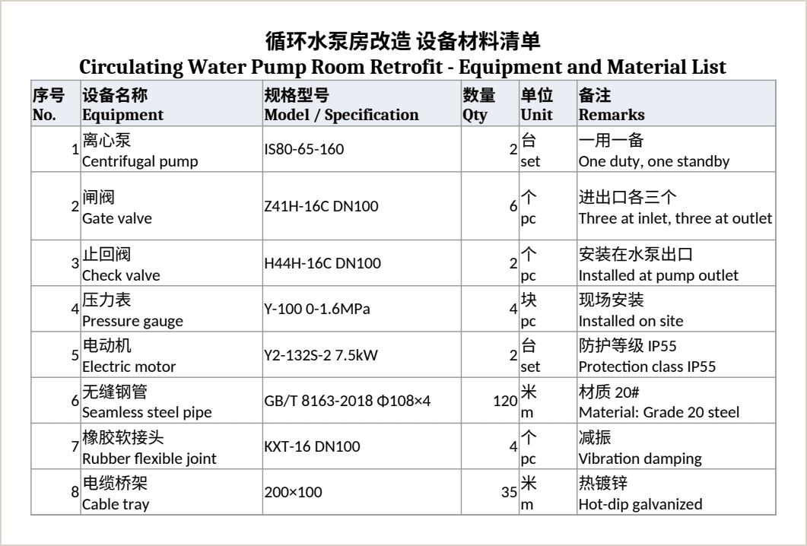
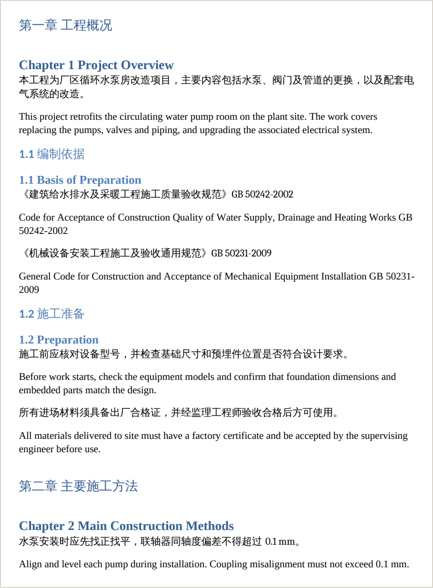
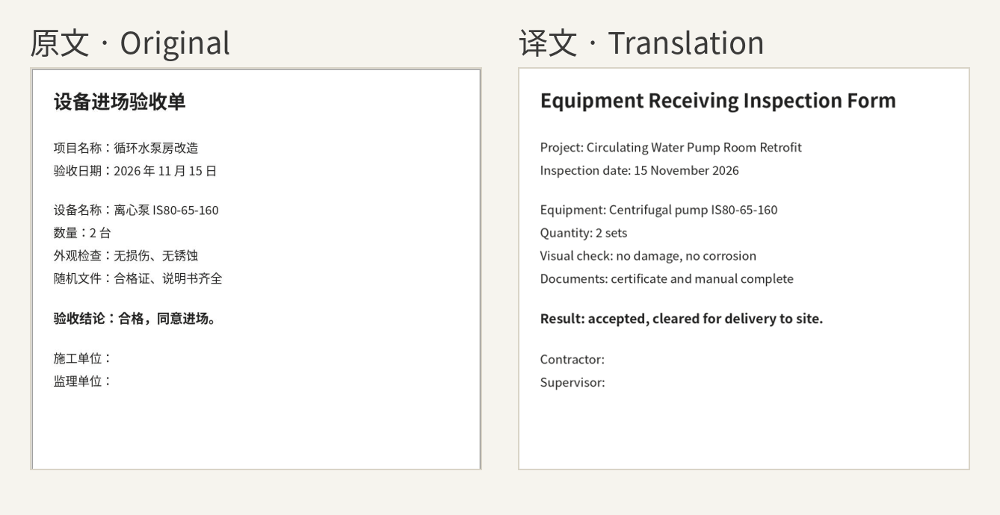
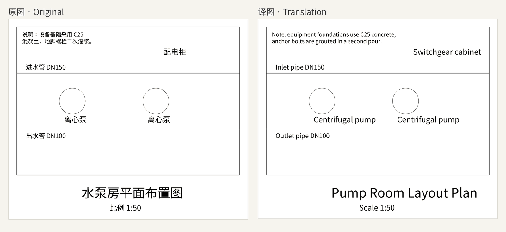

# Translator（XL Translator）

用大模型批量翻译 **Excel、Word、PDF、图片和 CAD 图纸（DWG / DXF）** 的桌面应用，支持 macOS 和 Windows。Excel 和 Word 默认写成原文加译文的双语文件（也可以只留译文），翻过的词句存进记忆库，下次优先复用，专业术语前后一致。

A desktop app for macOS and Windows that uses large language models to batch-translate **Excel, Word, PDF, images and CAD drawings (DWG / DXF)**. Excel and Word files come out bilingual by default (original plus translation, or translation only), and every translated term goes into a translation memory so later jobs reuse it and keep terminology consistent.

[下载最新版 · Download the latest release](https://github.com/KlaraGraff/XL_Translator/releases/latest)


> 本页截图用一套虚构的水泵房改造项目资料（材料清单、施工方案、验收单、平面图）实际跑出，译成英文，截图里是中文界面。界面还可以在「设置 → 外观与语言」里切换成英语或法语；输出文件夹名、报告文件和写进文档的复核标记目前仍是中文。
>
> The screenshots on this page come from real runs on a set of made-up sample files for a pump room retrofit project, translated into English, with the interface set to Chinese. The interface can also be switched to English or French under Settings → Appearance & language; output folder names, report files and review markers written into documents are still in Chinese.

## 能做什么 · Features

### Excel 表格 · Excel

支持 `.xlsx` 和旧版 `.xls`。可以翻译工作表名、公式单元格显示的内容和文件名；按译文调整行高，或者保持行高、缩小字号；拿不准的单元格涂色提醒复核。型号、标准号这类内容（如 `GB/T 8163-2018`）原样保留。

Supports `.xlsx` and legacy `.xls`. Sheet names, the displayed values of formula cells and file names can be translated too. Row heights adjust to the translation, or the font shrinks to fit; cells that need a second look are highlighted. Model numbers and standard codes such as `GB/T 8163-2018` are kept as they are.




### Word 文档 · Word

支持 `.docx` 和旧版 `.doc`，正文、表格和页眉页脚都能翻；可以保护封面和目录不翻，自动编号翻译后不错乱。文本框和脚注暂时不翻，遇到时会在结果里提示。

Supports `.docx` and legacy `.doc`: body text, tables, headers and footers. Cover pages and tables of contents can be left untouched, and automatic numbering stays intact. Text boxes and footnotes are not translated yet; they are reported when found.




### PDF 与图片 · PDF and images

逐页用图像模型把页面上的文字换成目标语言，尽量保留原来的版式和插图。图片支持 PNG、JPG、WebP、BMP、TIFF。可以让审核模型逐页检查，翻完还能单独重新生成某一页，并另存一份压缩 PDF。

Each page is redrawn in the target language by an image model that keeps the original layout and graphics as closely as possible. Images in PNG, JPG, WebP, BMP and TIFF are supported. A review model can check every page, any single page can be regenerated afterwards, and a compressed copy of the PDF can be saved as well.




### CAD 图纸 · CAD drawings

DXF 直接翻译；DWG 先在「插件」页连接 ODA File Converter。图块里的文字可以一起翻，GBK 等中文编码的旧图纸也能正确读写。

DXF files are translated directly; for DWG, connect ODA File Converter on the Plugins page first. Text inside blocks can be translated too, and older drawings saved in GBK or other Chinese encodings are read and written correctly.




### 记忆库 · Translation memory

Excel 和 Word 翻好的词句自动入库，翻译 Excel、Word 和 CAD 图纸时优先复用。固定的词条一定按你定的译法翻。支持导入、导出和清洗。

Terms translated in Excel and Word are stored automatically and reused when translating Excel, Word and CAD drawings. Pinned entries always use your preferred translation. The memory can be imported, exported and cleaned up.


### 任务中心 · Task center

不同类型的任务可以同时跑，可以随时停止（PDF 和 CAD 还能暂停），之后只补翻没翻完的部分。每个任务都有结果统计、需要复核的位置和生成的文件。支持浅色和深色模式。

Different kinds of jobs can run at the same time. Any job can be stopped (PDF and CAD jobs can also be paused) and later resumed to translate only what is left. Every job keeps its statistics, the places that need review, and the files it produced. Light and dark modes are both supported.


### 语言与场景 · Languages and domains

内置 59 种语言，源语言可以自动识别，也可以自定义目标语言。提供工程、资料管理、行政日常等场景提示词，也可以自己写。

59 built-in languages, automatic source-language detection, and custom target languages. Built-in prompts cover engineering, document control and everyday office text, and you can write your own.

## 支持的模型服务 · Model services

在「设置 → 模型服务」里填写服务商、模型和 API 密钥，测试连接通过后就能用。文档翻译、PDF 与图片、记忆库清洗可以各用各的模型。

Enter the provider, model and API key under Settings → Models, then test the connection. Document translation, PDF and image translation, and memory cleanup can each use a different model.

| | 中文 | English |
|---|---|---|
| 云端 · Cloud | OpenAI / ChatGPT、Claude（Anthropic）、DeepSeek、智谱 GLM、阿里百炼（通义）、硅基流动，以及任何 OpenAI 兼容接口 | OpenAI, Claude (Anthropic), DeepSeek, Zhipu GLM, Alibaba Qwen (DashScope), SiliconFlow, and any OpenAI-compatible API |
| 本机 · Local | Ollama、LM Studio，或其他 OpenAI 兼容的本地服务 | Ollama, LM Studio, or another OpenAI-compatible local server |
| PDF 与图片 · PDF and images | 需要能生成图片的模型：OpenAI、硅基流动或 OpenAI 兼容接口 | Needs an image-capable model: OpenAI, SiliconFlow or an OpenAI-compatible API |

文件在本机读取和写出，翻译时只把要翻译的文字（PDF 和图片是页面图像）发给你配置的模型服务；用本机模型时，文档内容不会离开你的电脑。

Files are read and written on your computer. Only the text to translate (page images for PDF and images) is sent to the model service you configure; with a local model, document content never leaves your computer.


## V10.0.0 主要变化 · What's new in V10.0.0

- 新增 CAD 图纸翻译，页面和流程与 Excel、Word、PDF 相同
- 新增英语和法语界面，在「设置 → 外观与语言」里切换
- 新配色：浅色模式改为柔和的暖米白，深色模式层次更分明
- 界面、运行日志、报错和报告里的说法统一，不再出现程序内部术语
- API 密钥被拒绝或额度用完时直接停下并说明原因；长时间限速时先保存已翻好的部分

<!-- English -->

- New: CAD drawing translation, with the same page and steps as Excel, Word and PDF
- New: English and French interface, selectable under Settings → Appearance & language
- New color scheme: a soft warm off-white light mode and a dark mode with clearer layering
- Consistent wording across the interface, run log, error messages and reports, with no internal technical terms
- If the API key is rejected or the quota runs out, the job stops and says why; under long rate limiting, finished work is saved first

完整说明见[发布页](https://github.com/KlaraGraff/XL_Translator/releases/latest)和 [CHANGELOG](docs/CHANGELOG.md)。See the [release page](https://github.com/KlaraGraff/XL_Translator/releases/latest) and the [CHANGELOG](docs/CHANGELOG.md) for details.

## 系统与下载 · System requirements and downloads

当前版本提供两个原生安装包：

- macOS（Apple Silicon，M 系列芯片）：`Translator_macOS_arm64_<版本>.dmg`，要求 **macOS 12.0 Monterey 及以上版本**
- Windows（x64）：`Translator_Windows_x64_<版本>_Setup.exe`，要求 **Windows 10 及以上版本**

打开[最新版发布页](https://github.com/KlaraGraff/XL_Translator/releases/latest)下载安装包；每个安装包都有同名的 `.sha256` 校验文件。不提供 Intel Mac 安装包与更新，Intel Mac 用户请继续使用旧版。

Two native installers are provided:

- macOS (Apple Silicon): `Translator_macOS_arm64_<version>.dmg`, requires **macOS 12.0 Monterey or later**
- Windows (x64): `Translator_Windows_x64_<version>_Setup.exe`, requires **Windows 10 or later**

Download them from the [latest release](https://github.com/KlaraGraff/XL_Translator/releases/latest); each installer comes with a `.sha256` checksum file of the same name. There is no installer or update for Intel Macs; Intel Mac users should keep using an older version.

### macOS 安装与首次打开 · Installing on macOS

下载后可在终端验证 · Verify the download in Terminal:

```bash
cd ~/Downloads
shasum -a 256 -c Translator_macOS_arm64_<版本>.dmg.sha256
```

校验结果必须显示 `OK`。

1. 打开已校验的 DMG，将 `Translator.app` 拖到 `Applications`。
2. 从“应用程序”启动 Translator。
3. 每一版的签名状态写在该版本的发布说明里。若说明写的是 Developer ID 签名并已通过 Apple 公证，双击即可打开；若写的是 ad-hoc 签名、未公证，macOS 会提示“无法验证开发者”，需要在“系统设置 → 隐私与安全性”中确认“仍要打开”。无论哪种情况，都只安装从官方发布页下载并通过上一步校验的 DMG，不要从其他来源找替代安装包。

The check must print `OK`.

1. Open the verified DMG and drag `Translator.app` into `Applications`.
2. Start Translator from Applications.
3. The release notes of each version state how it is signed. If they say Developer ID signed and Apple notarized, it opens with a double-click. If they say ad-hoc signed and not notarized, macOS warns that the developer cannot be verified; confirm "Open Anyway" under System Settings → Privacy & Security. Either way, only install a DMG downloaded from the official release page and verified in the step above.

macOS 的数据目录是 `~/Library/Application Support/Translator`。On macOS, app data lives in `~/Library/Application Support/Translator`.

### Windows 安装与首次打开 · Installing on Windows

下载后可在 PowerShell 验证（对比输出的哈希值与 `.sha256` 文件里的值一致）· Verify the download in PowerShell (the hash must match the one in the `.sha256` file):

```powershell
Get-FileHash "$env:USERPROFILE\Downloads\Translator_Windows_x64_<版本>_Setup.exe" -Algorithm SHA256
Get-Content "$env:USERPROFILE\Downloads\Translator_Windows_x64_<版本>_Setup.exe.sha256"
```

1. 运行已校验的 `Setup.exe`。安装只写入当前用户目录，不需要管理员权限。
2. Windows 安装包暂不携带代码签名，SmartScreen 可能提示“已保护你的电脑”；请先完成上一步校验，再选择“更多信息 → 仍要运行”。只对从官方发布页下载并通过校验的安装包这样做。
3. 应用界面依赖 Microsoft Edge WebView2 运行时。若系统缺少，安装器会联网自动安装；这是首次安装唯一可能需要网络的步骤。

1. Run the verified `Setup.exe`. It installs into your user folder and does not need administrator rights.
2. The Windows installer is not code-signed yet, so SmartScreen may say "Windows protected your PC". After verifying the checksum, choose "More info → Run anyway". Only do this for an installer downloaded from the official release page and verified.
3. The interface needs the Microsoft Edge WebView2 runtime. If it is missing, the installer downloads and installs it; this is the only step of a first install that may need the internet.

Windows 的数据目录是 `%LOCALAPPDATA%\Translator`。On Windows, app data lives in `%LOCALAPPDATA%\Translator`.

## 首次启动 · First launch

首次启动会显示快速开始，不会自动从其他目录导入旧版本数据。当前应用数据目录中已有的数据会按兼容规则读取或升级；遇到损坏数据时，会先备份原文件，再新建可用数据，并在设置中提示备份位置。如果原文件无法读取、备份或新建失败，会保留原件并说明原因，不保证能恢复其中的内容。

The first launch shows a quick-start guide and does not import data from other folders. Existing data in the app data folder is read or upgraded under the compatibility rules. Damaged data is backed up first, a working copy is created, and Settings shows where the backup is. If the original cannot be read, backed up or replaced, it is left in place and the reason is shown; its contents may not be recoverable.

## 使用边界 · What you need to know

标准 `.xlsx`、`.docx`、PDF、图片和 DXF 图纸不依赖 Microsoft Office。旧 `.xls`、`.doc` 高保真转换及部分编号处理可使用本机 Microsoft Office、LibreOffice 或系统转换工具；DWG 图纸需要 ODA File Converter。这些是可选本地软件，不随 Translator 安装包提供。应用会在需要时说明权限、格式保真和回退风险。

翻译前需要由用户在“设置 → 模型服务”中填写并主动测试可用的服务。快速开始不会自动发送 API 请求。帮助、更新检查、维护和脱敏诊断均在应用内提供；诊断不会自动上传，也不包含 API Key、原文、译文或完整 Prompt。

Standard `.xlsx`, `.docx`, PDF, images and DXF drawings do not need Microsoft Office. High-fidelity conversion of legacy `.xls` and `.doc` files and some numbering fixes can use Microsoft Office, LibreOffice or system converters on your computer; DWG drawings need ODA File Converter. These are optional and not bundled with Translator. The app explains permissions, fidelity and fallback risks when they come up.

Before translating, enter a model service under Settings → Models and test it yourself. The quick-start guide never sends API requests on its own. Help, update checks, maintenance and anonymized diagnostics are built in. Diagnostics are never uploaded automatically and never contain API keys, source text, translations or full prompts.

### 配置文件的导出与导入 · Exporting and importing settings

“设置 → 模型服务”可以把整份模型配置导出给同事。不含密钥的导出是明文 `.json`；含密钥的导出是加密的 `.xltcfg`，密钥段用应用内置的密钥加密，文件被改动过就无法导入，导出时可以选择 7 天 / 30 天 / 90 天 / 长期有效。

安全边界：任何装有本应用的人都能解开任意一份 `.xltcfg`。它防的是文件在传输途中被不相干的人看到，防不了拿到应用的人——不要把含密钥的配置文件发到公开群或网盘。导出时只会带上你自己在本机填写过的密钥，从别人的配置里导入来的密钥不会继续外传。

Settings → Models can export the whole model setup for a colleague. An export without keys is a plain `.json` file. An export with keys is an encrypted `.xltcfg` file: the keys are encrypted with a key built into the app, a modified file cannot be imported, and the export can be valid for 7, 30 or 90 days or without limit.

Security note: anyone who has the app can open any `.xltcfg` file. It protects the file from unrelated people while it is being sent, not from people who have the app, so do not post a file with keys in a public group or shared drive. An export only includes keys you entered on this computer; keys imported from someone else's file are never passed on.

## 版本更新 · Updates

应用启动后会在后台检查一次更新，发现新版时点亮侧栏“设置”的红点。在“设置 → 更新与关于”可以直接完成更新：应用下载官方更新包、校验签名、就地替换，签名不匹配的包一律拒装。macOS 替换完成后由用户决定何时重启；Windows 交由安装程序完成，安装前会先确认是否打断正在运行的任务。后台提醒可以暂停，也可以忽略某个具体版本。

应用内更新不可用时（例如直接从 DMG 里运行、安装目录不可写、架构不匹配、开发构建），应用会说明具体原因并退回到手动下载安装包，不会给一个点不动的按钮。取更新信息、下载、安装三步中任何一步失败都会说明是哪一步断的，当前已安装的版本不受影响。

手动下载走官方 GitHub Release 页，应用仅接受与本机系统和架构匹配且带 SHA-256 校验文件的完整发布包。

The app checks for updates once in the background after it starts and shows a red dot on Settings when a new version is available. Settings → Updates & about installs it directly: the app downloads the official package, verifies its signature and replaces itself, and refuses any package whose signature does not match. On macOS you choose when to restart; on Windows the installer takes over, after asking whether to interrupt running jobs. Update reminders can be paused, or a specific version can be skipped.

When in-app updating is not possible (for example when running straight from the DMG, when the install folder is read-only, on an architecture mismatch, or in a development build), the app says why and falls back to a manual download. If fetching update information, downloading or installing fails, the app says which step failed, and the installed version is left untouched.

Manual downloads come from the official GitHub Releases page. The app only accepts complete release packages that match your system and architecture and come with a SHA-256 checksum file.

## 开发 · Development

代码结构、一次任务的完整流程和「改什么去哪里」见 [架构说明](docs/ARCHITECTURE.md)；新增一个翻译板块按 [新增翻译板块清单](docs/ADDING_A_TRANSLATION_PAGE.md) 做。

The [architecture guide](docs/ARCHITECTURE.md) explains how the code is organized, how a job runs end to end and where to make each kind of change; to add a new translation page, follow the [checklist for a new translation page](docs/ADDING_A_TRANSLATION_PAGE.md). Both documents are in Chinese. The desktop shell is built with Tauri 2 (Rust), the interface in TypeScript, and the document engine in Python.

## 许可 · License

[MIT License](LICENSE)
